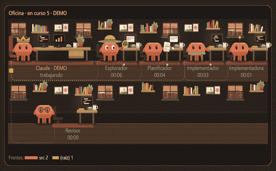

# Oficina de agentes

[Español](README.md) · **English**

A local, open-source monitor for your Claude Code agents: an office in a corner of your screen where you see what each agent is doing, when it finishes or needs you, and how much each project spends.



> [!NOTE]
> **Privacy.** Everything stays on your PC. The app has no telemetry and sends nothing anywhere: it reads files Claude Code already keeps on your machine. Its only network call is the update check against GitHub Releases, and you can turn it off (tray → *Check for updates automatically*, or in the first-run guide).

**Contents:** [Install](#install) · [What you'll see](#what-youll-see) · [Tray](#the-tray-menu) · [Notifications](#windows-notifications) · [Spending](#the-spending-panel) · [Unsigned executable](#the-executable-is-not-signed) · [Configuration](#configuration) · [Troubleshooting](#troubleshooting) · [Uninstall](#uninstall) · [Limitations](#limitations) · [Development](#development)

## Requirements

- Windows 10 or 11 (x64).
- Claude Code, installed and opened at least once.
- Languages: Spanish and English. It follows Windows; change it in tray → *Language*.

## Install

There are two pieces: the **desktop app** (it draws the office) and the **Oficina mod**, a Claude Code plugin that tells the app what your agents are doing.

**1. Install the app.** Download `Oficina-de-agentes-Setup-<version>.exe` from the [latest GitHub release](https://github.com/jrojo-LEEX/oficina-de-agentes/releases/latest) and run it. It installs for your user only, with no administrator rights, and opens when done.

Rather not install anything? Use `Oficina-de-agentes-<version>-portable.exe`: a single file, but it does not update itself.

Windows may warn you that the app is not signed: see [The executable is not signed](#the-executable-is-not-signed).

**2. Install the mod in Claude Code.** In any Claude Code session, type these two commands:

```text
/plugin marketplace add jrojo-LEEX/oficina-de-agentes
```

```text
/plugin install oficina@oficina-de-agentes
```

Then **open a new Claude Code session**: sessions that were already open do not load the mod.

**3. Check the guide.** On first run the app opens the *Status and help* guide. It checks Claude Code's folder and the mod, and each step turns green when it is ready; if something is missing, it shows the exact command with a *Copy* button. Launch an agent in Claude Code and it shows up in the corner of your screen.

No Claude Code at hand? In the guide, *Watch a demo scene*, or tray → *Office* → *Demo scenes*.

## What you'll see

The office appears in a corner of the screen (bottom right unless you pick another), above your windows. Clicks go through it and it never takes keyboard focus: you keep typing in your terminal as if it were not there.

- **Each Claude Code session is a boss**: that session's Claude, at a double desk.
- **Each subagent or teammate is a character** at a desk, with its name and how long it has been working. Each role (explore, plan, build, review, test) sits in its own area.
- **The state is the real one**, read from the tools each agent calls:

| State | What it means |
| --- | --- |
| Working | Thinking or writing its answer |
| Reading | Reading a file or a web page |
| Searching | Searching files or the web |
| Editing | Writing or editing a file |
| Using a tool | Running a command or another tool |
| Waiting for your permission | Raises a hand, and the office frame pulses yellow |
| Done / Failed | How it ended; if it failed, why |

Clues to follow the work:

- **Org chart**: a dotted line joins each agent to whoever launched it.
- **Same file**: an orange sheet when two agents wrote the same file in the last 10 minutes. A hint to check, not a sure conflict.
- **Tool trail**: green or red dots showing how its latest tool calls ended.
- **Fronts**: at the bottom, the folders touched most in the last half hour.
- **Offline**: when a session stops writing for more than 12 seconds its boss shows it in red; after 45 seconds the session disappears.
- **Limits**: at the bottom, how much of your 5-hour and weekly limits you have used.

**Shortcuts** (they work while another window has focus):

| Shortcut | What it does |
| --- | --- |
| `Ctrl+Alt+L` | Interactive mode: hover an agent to see its details (what it is doing, which file, for how long, who launched it). Also: click the tray icon |
| `Ctrl+Alt+H` | Hide or show the office |

Hiding it always leaves it passive. Change the shortcuts in the [configuration](#configuration).

## The tray menu

Right-click the tray icon (a desk with an orange screen):

| Item | What it does |
| --- | --- |
| Interactive mode / Show on screen | Same as the shortcuts |
| Spending by project and session | Opens the [spending panel](#the-spending-panel) |
| Today's report | Who worked today, for how long and how it ended |
| Office | Show or hide it, corner, size, style (illustrated or pixel art), layout, theme (automatic: night from 20:00 to 07:00 and party on Fridays), low-distraction mode and demo scenes |
| Notifications | Windows notifications, a sound when someone waits for your permission, mute and volume |
| Display | Which monitor the office lives on (only with more than one) |
| Whip (game mode) | An optional toy, **off by default**: a whip to shake the characters. It never touches the real agents |
| Record | A clip of the last 12 seconds or a timelapse (WebM), and replays. It records the office as data, never your screen. Saved to `Videos\Oficina de agentes` |
| Language | Automatic (Windows'), Spanish or English |
| Status and help… | The first-run guide |
| Check for updates / Check for updates automatically | Check now, or turn the automatic check off |
| Open when Windows starts | On by default |
| Open the config file (shortcuts)… | Opens `config.json` |
| Report that it got stuck… | Saves a diagnostics file in the app's folder |
| Quit | Closes the app |

## Windows notifications

| Notification | When |
| --- | --- |
| *Agent* is waiting for your permission | An agent, or a session's Claude, stops to ask for your permission. A short crack sound plays too (turn it off in tray → *Notifications*) |
| *Agent* finished / failed | A subagent finishes or fails. When more than three change at once, you get one summary instead |
| You used 80 % of your limit | Your 5-hour or weekly limit passes 80 %. Once per window, with the time it resets |
| Your week with Claude | Fridays from 17:00: the week's hours, tokens and projects |
| New version | An update is out, or ready to install |

Demo scenes never notify. To turn all of them off: tray → *Notifications* → *Windows notifications*.

## The spending panel

Tray → *Spending by project and session*. It shows how much you worked with Claude Code **today, in 7 days, in 30 days or overall**, by project, by client (if you set it up), by model or by session.

| Number | What it is |
| --- | --- |
| Active time | Time between the session's messages, leaving out pauses longer than 5 minutes. Subagents do not double it |
| Input | Fresh input tokens, including those written to the prompt cache |
| Output | Tokens the model wrote |
| Cache read | Context read back on every answer. Shown apart because it is far cheaper |
| Cost | What Claude Code reported, only for sessions the mod watched live; the rest show "—" |
| Limits | How much of the 5-hour and weekly windows you have used, and when each resets (Claude Code reports them to sessions running the mod) |

Each answer is counted once, subagents included. The **project** is the root of the git repository of the session's folder: a worktree counts as its repository. The **model** view has no time, only answers and tokens. There is also a 30-day chart (time and tokens) and a map of which days and hours you work.

**Where it comes from.** The transcripts Claude Code already keeps in `<Claude Code folder>\projects` (by default `%USERPROFILE%\.claude\projects`), so it includes your past sessions. The app reads them once and then, every minute, only what they grew by.

**What it stores.** Only numbers, in `%APPDATA%\oficina-de-agentes\ledger.json`:

- each session's id, its project folder's name and path, and the folder it last ran in;
- the session's custom title, if you set one;
- when it started and ended, and active time per day and per hour;
- model names, and counts of answers and tokens;
- the cost Claude Code reported while the mod was watching;
- to avoid counting twice: the transcripts' paths, how far each was read, and the ids of the latest answers.

It **never** stores message content: not what you wrote, not what Claude answered, not the content of your files.

**By client.** If your projects live in per-client folders, like `C:\work\clients\acme\tienda`, add `"clients"` to `clientFolders` in the [configuration](#configuration): that session then counts for client `acme`. Without `clientFolders` there is no client view.

## The executable is not signed

Version 1 has no code-signing certificate. Here is what happens and what you can do.

**SmartScreen.** Windows may show *"Windows protected your PC"*. Click **More info** → **Run anyway**.

**Smart App Control (Windows 11).** When it is on, which is common on fresh installs, it **blocks unsigned apps and offers no way around it**. You cannot allow just one app. Turning Smart App Control off is a security decision for the whole system, and **we do not recommend making it for this app**. Instead, run it from source, which uses Electron's own signed runtime. You need [Node.js 22.18 or newer](https://nodejs.org/) and [Git](https://git-scm.com/):

```powershell
git clone https://github.com/jrojo-LEEX/oficina-de-agentes.git
cd oficina-de-agentes
npm ci
npm start
```

Run this way it does not update itself: to get a new version, `git pull`, `npm ci` and `npm start`.

**How to verify a download.**

- Each release is built by GitHub Actions from the commit tagged `vX.Y.Z`. In the repository's *Actions* tab you can see that run, the exact commit and the full log.
- Each release's `latest.yml` holds the installer's SHA-512 (the `sha512` field, base64). Compute yours in PowerShell and compare:

```powershell
$file = "$env:USERPROFILE\Downloads\Oficina-de-agentes-Setup-1.0.0.exe"
[Convert]::ToBase64String([Security.Cryptography.SHA512]::Create().ComputeHash([IO.File]::ReadAllBytes($file)))
```

- GitHub also shows each release file's SHA-256; to compare it: `Get-FileHash <file> -Algorithm SHA256`.

**Updates.** The installed version downloads new versions by itself and installs them when it closes (or right away, from the tray). The updater (electron-updater) checks each download against the release's SHA-512 checksum, **not against a signature**: that catches a damaged download, but does not protect you if someone took over the release itself. If that worries you, turn the automatic check off and update by hand or from source.

## Configuration

Tray → *Open the config file (shortcuts)…* opens `%APPDATA%\oficina-de-agentes\config.json`. Almost everything is set from the tray; these fields only from the file:

| Field | What it is | Default |
| --- | --- | --- |
| `shortcuts.interactive` | Interactive-mode shortcut, in Electron's accelerator format | `"Control+Alt+L"` |
| `shortcuts.visible` | Hide/show shortcut | `"Control+Alt+H"` |
| `clientFolders` | Folders that hold one folder per client (letters, digits, `.`, `-`, `_`) | `[]` |
| `language` | `"auto"` (Windows'), `"es"` or `"en"` | `"auto"` |

For example:

```json
{
  "shortcuts": { "interactive": "Control+Alt+L", "visible": "Alt+Shift+O" },
  "clientFolders": ["clients", "clientes"],
  "language": "en"
}
```

- The file has more fields: leave the rest as they are.
- Save it as **UTF-8**. A BOM is fine.
- A value that does not fit falls back to its default without touching the rest.
- **Restart the app** so it reads the file (tray → *Quit*, then open it again). Do not change anything from the tray before restarting, or it will rewrite the file.

### Environment variables

| Variable | What for | Default |
| --- | --- | --- |
| `CLAUDE_CONFIG_DIR` | Claude Code's folder. The app honours it just like Claude Code does | `%USERPROFILE%\.claude` |
| `OFICINA_LIVE_DIR` | Where the mod writes, and the app reads, each session's state (an absolute path; the mod and the app must see the same one) | `<Claude Code folder>\oficina-live` |
| `OFICINA_USER_DATA_DIR` | The app's own folder (config, spending ledger, logs) | `%APPDATA%\oficina-de-agentes` |

If you use `CLAUDE_CONFIG_DIR`, set it as a **Windows user environment variable**, not only in one terminal: the app, started from the Start menu, has to see the same value as Claude Code. The mod reads two more (`OFICINA_LANG`, `OFICINA_LOG`): see the [mod's README](plugin/oficina/README.md).

## Troubleshooting

**No agents show up.** Open tray → *Status and help…*. The guide checks everything and gives you the missing command:

- *Missing*: type the two commands from [step 2](#install).
- *Your mod is out of date*: `/plugin marketplace update oficina-de-agentes`, then `/plugin update oficina@oficina-de-agentes`.
- *It is installed but turned off*: `/plugin enable oficina@oficina-de-agentes`.

After installing, updating or enabling the mod, **open a new Claude Code session**.

**The guide does not find Claude Code's folder**, or finds another one. Claude Code and the app see a different `CLAUDE_CONFIG_DIR`. The guide shows the folder the app uses. Set the variable for your Windows user (see [Environment variables](#environment-variables)) and restart both the app and Claude Code.

**A shortcut does nothing.** When another program holds it, the tray shows *Shortcut taken*. Pick another in the [configuration](#configuration).

**The office is hidden behind a game or a video.** Exclusive fullscreen can cover it.

**Cost shows "—".** The mod did not watch that session live (for example, it predates the install). Time and tokens are still there.

**It got stuck.** Tray → *Report that it got stuck…* saves a `diagnostico-<date>.json` in `%APPDATA%\oficina-de-agentes`. Review it before attaching it to an issue.

## Uninstall

1. Optionally, untick tray → *Open when Windows starts* (especially with the portable version).
2. **The app**: Windows Settings → *Apps* → *Installed apps* → *Oficina de agentes* → *Uninstall*. The portable one: quit it and delete the `.exe`.
3. **The mod**, in Claude Code:

   ```text
   /plugin uninstall oficina@oficina-de-agentes
   ```

   To remove the marketplace as well: `/plugin marketplace remove oficina-de-agentes`.
4. **Your data** is not deleted for you. Delete it by hand if you want:
   - `%APPDATA%\oficina-de-agentes`: config, spending ledger and logs;
   - `<Claude Code folder>\oficina-live`: the session state the mod writes;
   - `Videos\Oficina de agentes`: your recordings.

## Limitations

- **Windows only** (10 and 11) in version 1.
- **One display at a time**: the office lives on the display you pick in the tray.
- **Exclusive fullscreen**: games and videos can cover it.
- **Unsigned**: see [above](#the-executable-is-not-signed).
- **Cost and limits** only for sessions the mod watched live.

## Development

You need Node.js 22.18 or newer and Git. Details in [CONTRIBUTING.md](CONTRIBUTING.md) and [docs/ARCHITECTURE.md](docs/ARCHITECTURE.md).

| Command | What it does |
| --- | --- |
| `npm ci` | Installs dependencies (and downloads Electron) |
| `npm start` | Builds and opens the app |
| `npm test` | Unit tests (`test:legacy` on node:test and `test:unit` on Vitest) |
| `npm run test:e2e` | End-to-end tests with Playwright on the real app (build first with `npm run build`) |
| `npm run test:plugin` / `npm run validate:plugin` | Test and validate the mod; they need the `claude` CLI (or `CLAUDE_BIN`) |
| `npm run typecheck` | Checks types |
| `npm run lint` / `npm run format` | Biome |
| `npm run selftest` | Opens the app with a simulated hand and writes `selftest-out/report.json` and screenshots |
| `npm run dist` | Builds the installer and the portable version in `release\`, without publishing |

## License and credits

[MIT](LICENSE). The whip sounds are real recordings released under CC0 (public domain) on [BigSoundBank](https://bigsoundbank.com/); details in [`src/sounds/README.md`](src/sounds/README.md).

Oficina de agentes is an independent project: it is not made or endorsed by Anthropic.

Security: [SECURITY.md](SECURITY.md) · Changes: [CHANGELOG.md](CHANGELOG.md)
