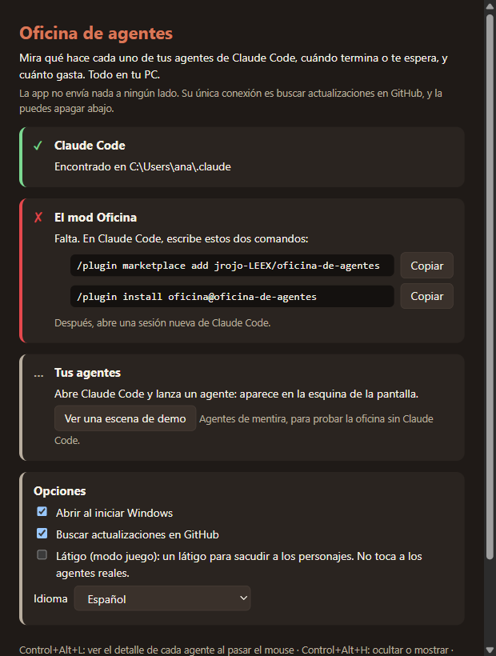

# Oficina de agentes

**Español** · [English](README.en.md)

Un monitor local y de código abierto de tus agentes de Claude Code: una oficina en una esquina de la pantalla donde ves qué hace cada agente, cuándo termina o te espera, y cuánto gasta cada proyecto.


> [!NOTE]
> **Privacidad.** Todo queda en tu PC. La app no tiene telemetría y no envía nada a ningún lado: lee archivos que Claude Code ya guarda en tu equipo. Su única conexión de red es buscar actualizaciones en GitHub Releases, y la puedes apagar (bandeja → *Buscar actualizaciones solo*, o en la guía de inicio).

**Contenido:** [Instalación](#instalación) · [Qué vas a ver](#qué-vas-a-ver) · [Bandeja](#el-menú-de-la-bandeja) · [Avisos](#avisos-de-windows) · [Gasto](#el-panel-de-gasto) · [Ejecutable sin firmar](#el-ejecutable-no-está-firmado) · [Configuración](#configuración) · [Problemas](#problemas-frecuentes) · [Desinstalar](#desinstalar) · [Limitaciones](#limitaciones) · [Desarrollo](#desarrollo)

## Requisitos

- Windows 10 u 11 (x64).
- Claude Code instalado y abierto al menos una vez.
- Idiomas: español e inglés. Sigue al de Windows; se cambia en bandeja → *Idioma*.

## Instalación

Son dos piezas: la **app de escritorio** (dibuja la oficina) y el **mod Oficina**, un plugin de Claude Code que cuenta a la app qué hacen tus agentes.

**1. Instala la app.** Descarga `Oficina-de-agentes-Setup-<versión>.exe` de la [última versión en GitHub Releases](https://github.com/jrojo-LEEX/oficina-de-agentes/releases/latest) y ábrelo. Se instala solo para tu usuario, sin pedir permisos de administrador, y se abre al terminar.

¿Prefieres no instalar nada? Usa `Oficina-de-agentes-<versión>-portable.exe`: es un solo archivo, pero no se actualiza solo.

Windows puede advertirte que la app no está firmada: lee [El ejecutable no está firmado](#el-ejecutable-no-está-firmado).

**2. Instala el mod en Claude Code.** En cualquier sesión de Claude Code, escribe estos dos comandos:

```text
/plugin marketplace add jrojo-LEEX/oficina-de-agentes
```

```text
/plugin install oficina@oficina-de-agentes
```

Después **abre una sesión nueva** de Claude Code: las que ya estaban abiertas no cargan el mod.

**3. Mira la guía.** La primera vez, la app abre la guía *Estado y ayuda*. Revisa la carpeta de Claude Code y el mod, y cada paso se pone en verde cuando está listo; si falta algo, te muestra el comando exacto con un botón *Copiar*. Lanza un agente en Claude Code y aparece en la esquina de la pantalla.



¿Sin Claude Code a mano? En la guía, *Ver una escena de demo*, o bandeja → *Oficina* → *Escenas de demo*.

## Qué vas a ver

En una esquina de la pantalla (abajo a la derecha, si no eliges otra) aparece la oficina, por encima de tus ventanas. Los clics la atraviesan y nunca te quita el foco del teclado: sigues escribiendo en la terminal como si no estuviera.

- **Cada sesión de Claude Code es un jefe**: el Claude de esa sesión, en un escritorio doble.
- **Cada subagente o compañero de equipo es un personaje** en su escritorio, con su nombre y el tiempo que lleva. Cada rol (explorar, planificar, implementar, revisar, probar) se sienta en su zona.
- **El estado es el real**, sacado de las herramientas que usa cada agente:

| Estado | Qué significa |
| --- | --- |
| Trabajando | Pensando o escribiendo la respuesta |
| Leyendo | Lee un archivo o una página |
| Buscando | Busca en archivos o en la web |
| Editando | Escribe o edita un archivo |
| Usando una herramienta | Corre un comando u otra herramienta |
| Espera tu permiso | Levanta la mano y el marco de la oficina parpadea en amarillo |
| Terminó / Falló | Cómo acabó; si falló, el motivo |

Pistas para entender el trabajo:

- **Organigrama**: una línea punteada une a cada agente con quien lo lanzó.
- **Mismo archivo**: una hoja naranja si dos agentes escribieron el mismo archivo en los últimos 10 minutos. Es una pista para revisar, no un conflicto seguro.
- **Rastro de herramientas**: puntos verdes o rojos con cómo terminaron sus últimas herramientas.
- **Frentes**: al pie, las carpetas más tocadas en la última media hora.
- **Sin conexión**: si una sesión deja de escribir más de 12 segundos, el jefe lo muestra en rojo; a los 45 segundos la sesión desaparece.
- **Límites**: al pie, cuánto usaste de tu límite de 5 horas y del semanal.

**Atajos** (funcionan aunque otra ventana tenga el foco):

| Atajo | Qué hace |
| --- | --- |
| `Ctrl+Alt+L` | Modo interactivo: pasa el mouse por un agente para ver su detalle (qué hace, qué archivo, hace cuánto, quién lo lanzó). También: clic en el ícono de la bandeja |
| `Ctrl+Alt+H` | Ocultar o mostrar la oficina |

Ocultarla siempre la deja en modo pasivo. Los atajos se cambian en la [configuración](#configuración).

## El menú de la bandeja

Clic derecho en el ícono de la bandeja (un escritorio con una pantalla naranja):

| Opción | Qué hace |
| --- | --- |
| Modo interactivo / Mostrar en pantalla | Lo mismo que los atajos |
| Gasto por proyecto y sesión | Abre el [panel de gasto](#el-panel-de-gasto) |
| Parte del día | Quién trabajó hoy, cuánto y cómo terminó |
| Oficina | Mostrarla u ocultarla, esquina, tamaño, estilo (ilustrado o pixel art), distribución, tema (automático: de noche de 20 a 7 y de fiesta los viernes), modo de baja distracción y escenas de demo |
| Avisos | Avisos de Windows, sonido cuando alguien espera tu permiso, silenciar y volumen |
| Pantalla | En qué monitor vive la oficina (solo con más de uno) |
| Látigo (modo juego) | Un juguete opcional, **apagado por defecto**: un látigo para sacudir a los personajes. No toca a los agentes reales |
| Grabar | Clip de los últimos 12 segundos o timelapse (WebM), y replays. Graba la oficina como datos, nunca tu pantalla. Van a `Videos\Oficina de agentes` |
| Idioma | Automático (el de Windows), español o inglés |
| Estado y ayuda… | La guía de inicio |
| Buscar actualizaciones / Buscar actualizaciones solo | Buscar ahora, o apagar la búsqueda automática |
| Abrir al iniciar Windows | Viene activado |
| Abrir configuración (atajos)… | Abre `config.json` |
| Reportar que se trabó… | Guarda un diagnóstico en la carpeta de la app |
| Salir | Cierra la app |

## Avisos de Windows

| Aviso | Cuándo |
| --- | --- |
| *Agente* espera tu permiso | Un agente o el Claude de una sesión se detiene a pedirte permiso. Además suena un chasquido corto (bandeja → *Avisos* para apagarlo) |
| *Agente* terminó / falló | Un subagente termina o falla. Si cambian más de tres a la vez, llega un solo aviso con el resumen |
| Usaste el 80 % de tu límite | Tu límite de 5 horas o el semanal pasa el 80 %. Una vez por ventana, con la hora en que se renueva |
| Tu semana con Claude | Los viernes desde las 17: horas, tokens y proyectos de la semana |
| Versión nueva | Hay una actualización, o está lista para instalarse |

Las escenas de demo nunca avisan. Para apagar todos los avisos: bandeja → *Avisos* → *Avisos de Windows*.

## El panel de gasto

Bandeja → *Gasto por proyecto y sesión*. Muestra cuánto trabajaste con Claude Code **hoy, en 7 días, en 30 días o en total**, por proyecto, por cliente (si lo configuras), por modelo o por sesión.

| Número | Qué es |
| --- | --- |
| Tiempo activo | El tiempo entre mensajes de la sesión, sin contar pausas de más de 5 minutos. Los subagentes no lo duplican |
| Entrada | Tokens nuevos de entrada, incluidos los que se escriben en la caché |
| Salida | Tokens que escribió el modelo |
| Caché leída | El contexto que se vuelve a leer en cada respuesta. Va aparte porque es mucho más barato |
| Costo | El que informó Claude Code, solo de las sesiones que el mod vio en vivo; las demás muestran "—" |
| Límites | Cuánto usaste de la ventana de 5 horas y de la semanal, y cuándo se renueva cada una (las informa Claude Code a las sesiones con el mod) |

Cada respuesta se cuenta una sola vez, subagentes incluidos. El **proyecto** es la raíz del repositorio git de la carpeta de la sesión: un worktree cuenta como su repositorio. El **modelo** no reparte tiempo, solo respuestas y tokens. Además hay un gráfico de 30 días (tiempo y tokens) y un mapa de en qué días y horas trabajas.

**De dónde sale.** De las transcripciones que Claude Code ya guarda en `<carpeta de Claude Code>\projects` (por defecto `%USERPROFILE%\.claude\projects`), así que incluye tus sesiones anteriores. La app las lee una vez y después, cada minuto, solo lo que creció.

**Qué guarda.** Solo números, en `%APPDATA%\oficina-de-agentes\ledger.json`:

- el id de cada sesión, el nombre y la ruta de la carpeta de su proyecto, y la carpeta donde corrió por última vez;
- el título de la sesión, si le pusiste uno;
- cuándo empezó y terminó, y el tiempo activo por día y por hora;
- los nombres de los modelos, la cantidad de respuestas y de tokens;
- el costo que informó Claude Code mientras el mod la veía;
- para no contar dos veces: las rutas de las transcripciones, hasta dónde se leyó cada una y los ids de las últimas respuestas.

**Nunca** guarda el contenido de los mensajes, ni lo que escribiste, ni lo que respondió Claude, ni el contenido de tus archivos.

**Por cliente.** Si tus proyectos están en carpetas por cliente, como `C:\work\clients\acme\tienda`, agrega `"clients"` a `clientFolders` en la [configuración](#configuración): esa sesión cuenta para el cliente `acme`. Sin `clientFolders` no aparece la vista por cliente.

## El ejecutable no está firmado

La versión 1 no tiene certificado de firma de código. Esto es lo que pasa y qué puedes hacer.

**SmartScreen.** Windows puede mostrar *"Windows protegió tu PC"*. Haz clic en **Más información** → **Ejecutar de todas formas**.

**Smart App Control (Windows 11).** Si está activado, algo común en equipos recién instalados, **bloquea las apps sin firmar y no ofrece forma de saltarlo**. No se puede permitir una sola app. Apagar Smart App Control es una decisión de seguridad para todo el sistema, y **no te recomendamos tomarla por esta app**. En su lugar, córrela desde el código fuente, que usa el runtime de Electron, que sí está firmado. Necesitas [Node.js 22.18 o más nuevo](https://nodejs.org/) y [Git](https://git-scm.com/):

```powershell
git clone https://github.com/jrojo-LEEX/oficina-de-agentes.git
cd oficina-de-agentes
npm ci
npm start
```

Así no se actualiza sola: para traer una versión nueva, `git pull`, `npm ci` y `npm start`.

**Cómo verificar una descarga.**

- El release lo compila GitHub Actions a partir del commit con la etiqueta `vX.Y.Z`. En la pestaña *Actions* del repositorio puedes ver esa ejecución, el commit exacto y el registro completo.
- El archivo `latest.yml` de cada release trae el SHA-512 del instalador (campo `sha512`, en base64). Calcula el de tu descarga en PowerShell y compáralos:

```powershell
$file = "$env:USERPROFILE\Downloads\Oficina-de-agentes-Setup-1.0.0.exe"
[Convert]::ToBase64String([Security.Cryptography.SHA512]::Create().ComputeHash([IO.File]::ReadAllBytes($file)))
```

- GitHub también muestra el SHA-256 de cada archivo del release; para compararlo: `Get-FileHash <archivo> -Algorithm SHA256`.

**Actualizaciones.** La versión instalada descarga las nuevas sola y las instala al cerrarse (o al momento, desde la bandeja). El actualizador (electron-updater) comprueba cada descarga contra el checksum SHA-512 del release, **no contra una firma**: eso detecta una descarga dañada, pero no protege si alguien tomara el control del release. Si eso te preocupa, apaga la búsqueda automática y actualiza a mano o desde el código.

## Configuración

Bandeja → *Abrir configuración (atajos)…* abre `%APPDATA%\oficina-de-agentes\config.json`. Casi todo se cambia desde la bandeja; estos campos solo desde el archivo:

| Campo | Qué es | Por defecto |
| --- | --- | --- |
| `shortcuts.interactive` | Atajo del modo interactivo, con el formato de Electron | `"Control+Alt+L"` |
| `shortcuts.visible` | Atajo para ocultar o mostrar | `"Control+Alt+H"` |
| `clientFolders` | Carpetas que guardan una carpeta por cliente (letras, números, `.`, `-`, `_`) | `[]` |
| `language` | `"auto"` (el de Windows), `"es"` o `"en"` | `"auto"` |

Por ejemplo:

```json
{
  "shortcuts": { "interactive": "Control+Alt+L", "visible": "Alt+Shift+O" },
  "clientFolders": ["clients", "clientes"],
  "language": "es"
}
```

- El archivo tiene más campos: deja los demás como están.
- Guárdalo en **UTF-8**. Un BOM no molesta.
- Un valor que no sirve vuelve a su valor por defecto sin afectar al resto.
- **Reinicia la app** para que lo lea (bandeja → *Salir* y ábrela de nuevo). Antes de reiniciar no cambies nada desde la bandeja, porque reescribiría el archivo.

### Variables de entorno

| Variable | Para qué | Por defecto |
| --- | --- | --- |
| `CLAUDE_CONFIG_DIR` | La carpeta de Claude Code. La app la respeta igual que Claude Code | `%USERPROFILE%\.claude` |
| `OFICINA_LIVE_DIR` | Dónde el mod escribe y la app lee el estado de cada sesión (ruta absoluta; el mod y la app deben ver la misma) | `<carpeta de Claude Code>\oficina-live` |
| `OFICINA_USER_DATA_DIR` | La carpeta propia de la app (configuración, registro de gasto, logs) | `%APPDATA%\oficina-de-agentes` |

Si usas `CLAUDE_CONFIG_DIR`, defínela como variable de entorno **de tu usuario de Windows**, no solo en una terminal: la app, abierta desde el menú Inicio, tiene que ver el mismo valor que Claude Code. El mod tiene dos variables más (`OFICINA_LANG`, `OFICINA_LOG`): mira el [README del mod](plugin/oficina/README.md).

## Problemas frecuentes

**No aparece ningún agente.** Abre bandeja → *Estado y ayuda…*. La guía revisa todo y te da el comando que falta:

- *Falta*: escribe los dos comandos del [paso 2](#instalación).
- *Tienes una versión vieja del mod*: `/plugin marketplace update oficina-de-agentes` y luego `/plugin update oficina@oficina-de-agentes`.
- *Está instalado pero apagado*: `/plugin enable oficina@oficina-de-agentes`.

Después de instalar, actualizar o encender el mod, **abre una sesión nueva** de Claude Code.

**La guía no encuentra la carpeta de Claude Code**, o encuentra otra. Claude Code y la app están viendo un `CLAUDE_CONFIG_DIR` distinto. La guía muestra la carpeta que usa la app. Define la variable para tu usuario de Windows (ver [Variables de entorno](#variables-de-entorno)) y reinicia la app y Claude Code.

**El atajo no responde.** Si otro programa ya lo tiene, la bandeja muestra *Atajo ocupado*. Elige otro en la [configuración](#configuración).

**La oficina no se ve sobre un juego o un video.** La pantalla completa exclusiva puede taparla.

**El costo dice "—".** Esa sesión no la vio el mod en vivo (por ejemplo, es anterior a instalarlo). El tiempo y los tokens sí aparecen.

**Se trabó.** Bandeja → *Reportar que se trabó…* guarda un `diagnostico-<fecha>.json` en `%APPDATA%\oficina-de-agentes`. Revísalo antes de adjuntarlo a un issue.

## Desinstalar

1. Si quieres, desmarca bandeja → *Abrir al iniciar Windows* (sobre todo con la versión portable).
2. **La app**: Configuración de Windows → *Aplicaciones* → *Aplicaciones instaladas* → *Oficina de agentes* → *Desinstalar*. La portable: ciérrala y borra el `.exe`.
3. **El mod**, en Claude Code:

   ```text
   /plugin uninstall oficina@oficina-de-agentes
   ```

   Y si quieres quitar también el marketplace: `/plugin marketplace remove oficina-de-agentes`.
4. **Tus datos** no se borran solos. Bórralos a mano si quieres:
   - `%APPDATA%\oficina-de-agentes`: configuración, registro de gasto y logs;
   - `<carpeta de Claude Code>\oficina-live`: el estado de las sesiones que escribe el mod;
   - `Videos\Oficina de agentes`: tus grabaciones.

## Limitaciones

- **Solo Windows** 10 y 11 en la versión 1.
- **Un monitor a la vez**: la oficina vive en la pantalla que elijas en la bandeja.
- **Pantalla completa exclusiva**: juegos y videos pueden taparla.
- **Sin firmar**: ver [arriba](#el-ejecutable-no-está-firmado).
- **Costo y límites** solo de las sesiones que el mod vio en vivo.

## Desarrollo

Necesitas Node.js 22.18 o más nuevo y Git. Detalles en [CONTRIBUTING.md](CONTRIBUTING.md) y en [docs/ARCHITECTURE.md](docs/ARCHITECTURE.md).

| Comando | Qué hace |
| --- | --- |
| `npm ci` | Instala las dependencias (y descarga Electron) |
| `npm start` | Compila y abre la app |
| `npm test` | Pruebas unitarias (`test:legacy` con node:test y `test:unit` con Vitest) |
| `npm run test:e2e` | Pruebas de punta a punta con Playwright sobre la app real (compila antes con `npm run build`) |
| `npm run test:plugin` / `npm run validate:plugin` | Prueban y validan el mod; necesitan el CLI `claude` (o `CLAUDE_BIN`) |
| `npm run typecheck` | Verifica los tipos |
| `npm run lint` / `npm run format` | Biome |
| `npm run selftest` | Abre la app con una mano simulada y escribe `selftest-out/report.json` y capturas |
| `npm run dist` | Genera el instalador y la versión portable en `release\`, sin publicar |

## Licencia y créditos

[MIT](LICENSE). Los sonidos del látigo son grabaciones reales con licencia CC0 (dominio público) de [BigSoundBank](https://bigsoundbank.com/); detalles en [`src/sounds/README.md`](src/sounds/README.md).

Oficina de agentes es un proyecto independiente: no es un producto de Anthropic ni está respaldado por Anthropic.

Seguridad: [SECURITY.md](SECURITY.md) · Cambios: [CHANGELOG.md](CHANGELOG.md)
